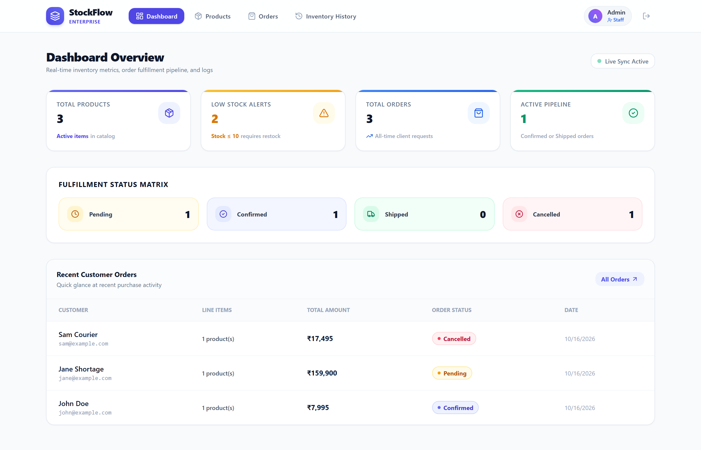
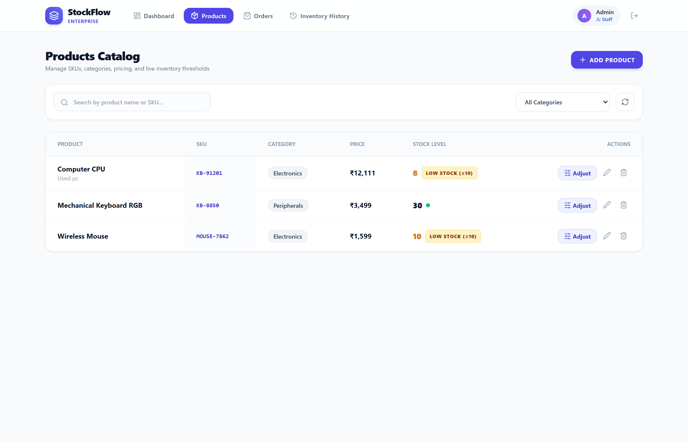
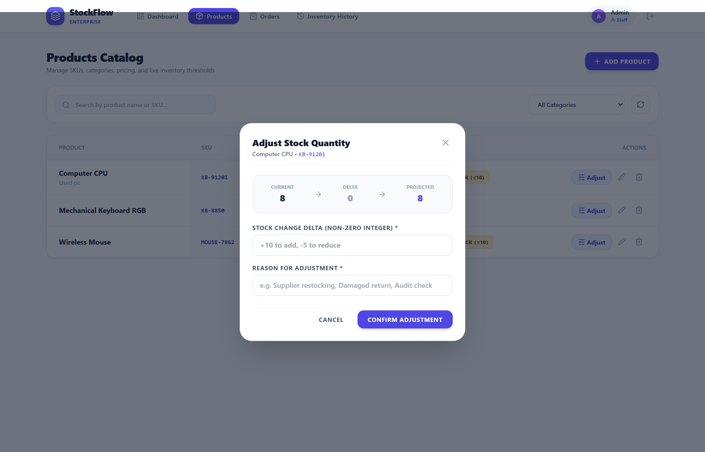
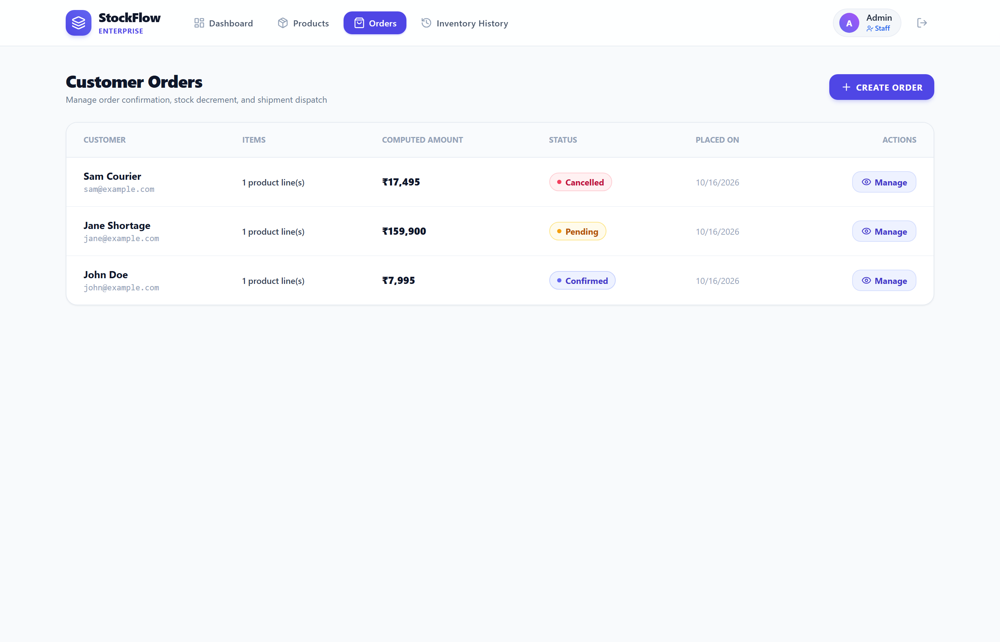
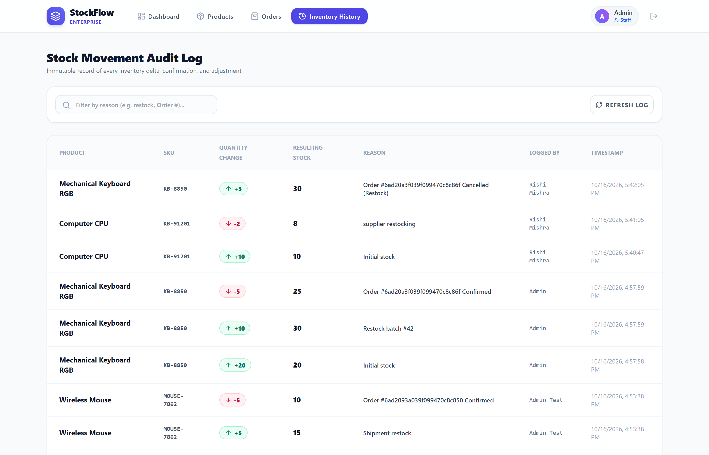
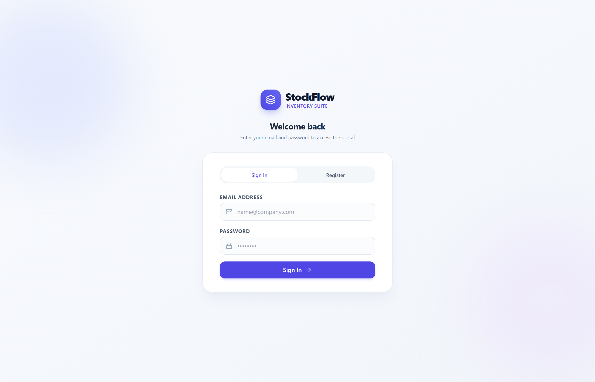

# 📦 StockFlow — Modern Inventory & Order Management System

A high-performance, full-stack **MERN** (MongoDB Atlas, Express, React, Node.js) inventory management platform engineered for real-time stock control, atomic concurrency locking, automated order fulfillment, and comprehensive audit history.

---

## 📸 Application Screenshots

### 1. Real-Time Analytics Dashboard
> Complete operational overview with live product counts, low stock alerts ($\le 10$), order fulfillment pipelines, and recent customer activities.



---

### 2. Products Catalog & Live Stock Thresholds
> Searchable catalog with SKU indexing, category filters, and automatic low-stock status flags.



---

### 3. Atomic Stock Adjustment Modal
> Safe inventory delta adjustments preventing negative stock through atomic MongoDB queries. Includes real-time projected stock calculations.



---

### 4. Customer Order Lifecycle & 409 Conflict Handling
> Order processing workflow (`Pending` $\rightarrow$ `Confirmed` $\rightarrow$ `Shipped` or `Cancelled`). Automatically calculates server-side totals and prevents race-condition shortages with clear HTTP 409 notifications.



---

### 5. Inventory Movement Audit Log
> Immutable ledger logging every stock increase, decrease, customer order deduction, and restocking event.



---

### 6. Authentication & Role-Based Access Control
> Secure JWT authentication. The first registered user is automatically provisioned as **Admin**, while subsequent users are registered as **Staff**.



---

## 🎥 End-to-End Procedure & Walkthrough Video Guide

```
+----------------------------------------------------------------------------------------------------+
|                                    OPERATIONAL LIFECYCLE                                           |
|                                                                                                    |
|  [Register / Login] ---> [Create Products] ---> [Adjust Stock] ---> [Place Order] ---> [Fulfill]  |
|          |                        |                    |                   |                |      |
|    Admin / Staff          Low-Stock <= 10       Atomic $inc /       Server Pricing     Confirmed   |
|     (JWT 1-hr)               Indicators           $gte Lock           Calculation     Decrements   |
+----------------------------------------------------------------------------------------------------+
```

### Complete Video Walkthrough Procedure

| Phase | Action | System Behavior | HTTP Response |
| :--- | :--- | :--- | :--- |
| **Step 1** | **User Registration** | First user registers at `/login`. Assigned role `admin`. Generates signed JWT (1-hour validity). | `201 Created` |
| **Step 2** | **Add Catalog Items** | Create products with SKU, title, category, price (in paise/rupees), and initial inventory. | `201 Created` |
| **Step 3** | **Adjust Stock Quantity** | Submit positive delta (restock) or negative delta (write-off). Atomic check `stock >= -delta`. | `200 OK` |
| **Step 4** | **Prevent Overselling** | Attempting to decrement more stock than available triggers conflict block. | `409 Conflict` |
| **Step 5** | **Customer Order Placement** | Customer selects items & quantities. Server calculates item prices directly from database. | `201 Created` |
| **Step 6** | **Order Confirmation** | Transition `Pending` $\rightarrow$ `Confirmed`. Atomically decrements quantities and logs movements. | `200 OK` |
| **Step 7** | **Shipment Dispatch** | Transition `Confirmed` $\rightarrow$ `Shipped`. Locks order in terminal fulfilled state. | `200 OK` |
| **Step 8** | **Order Cancellation** | Cancelling a `Confirmed` order automatically restores inventory levels and logs restocking. | `200 OK` |

> 📹 **Video Demo**: To record a video demonstration or capture browser interaction, launch the development servers below and follow the 8-step walkthrough sequence.

---

## 🛠️ Technology Stack

| Layer | Technologies |
| :--- | :--- |
| **Frontend** | React 18, Vite, Tailwind CSS, React Router v6, Axios, Lucide React |
| **Backend** | Node.js, Express, Mongoose ODM, MongoDB Atlas (Replica Set) |
| **Security & Auth** | JWT (JSON Web Tokens), Bcrypt.js, CORS, Helmet |
| **Data Integrity** | Atomic `$inc` with `$gte` locking, Mongo sessions/transactions, Zod validation |

---

## ⚡ Quick Start & Installation

### Prerequisites
- **Node.js** (v18+ recommended)
- **MongoDB Atlas** connection string (or replica-set MongoDB URI)

### 1. Clone Repository
```bash
git clone <repository-url>
cd inv-system
```

### 2. Backend Setup
1. Navigate to `/backend` and install dependencies:
   ```bash
   cd backend
   npm install
   ```
2. Configure environment variables in `backend/.env` using the template:
   ```bash
   cp .env.example .env
   ```
   *Required variables in `backend/.env`:*
   ```env
   PORT=5000
   MONGO_URI=mongodb+srv://<username>:<password>@cluster.mongodb.net/inventory?retryWrites=true&w=majority
   JWT_SECRET=your_super_secret_jwt_key
   CORS_ORIGIN=http://localhost:5173
   LOW_STOCK_DEFAULT=10
   ```
3. Start the backend server:
   ```bash
   npm start
   # or development mode with hot reload
   npm run dev
   ```

### 3. Frontend Setup
1. Open a new terminal and navigate to `/frontend`:
   ```bash
   cd frontend
   npm install
   ```
2. Configure frontend environment variables in `frontend/.env`:
   ```bash
   cp .env.example .env
   ```
   *Contents of `frontend/.env`:*
   ```env
   VITE_API_URL=http://localhost:5000/api
   ```
3. Start Vite development server:
   ```bash
   npm run dev
   ```
4. Access the web application at **`http://localhost:5173`**.

---

## 📡 API Reference

### Authentication
- `POST /api/auth/register` — Register new user (First user becomes `admin`)
- `POST /api/auth/login` — Sign in and receive JWT bearer token
- `GET /api/auth/me` — Retrieve active session profile

### Products & Inventory
- `GET /api/products` — Retrieve catalog (`?search=` by name/SKU, `?category=`)
- `GET /api/products/low-stock` — Products with stock $\le 10$
- `GET /api/products/categories` — Distinct list of existing categories
- `POST /api/products` — Create new product
- `PUT /api/products/:id` — Update product details
- `DELETE /api/products/:id` — Soft-delete product (`archived: true`)
- `POST /api/products/:id/adjust` — Atomic stock adjustment `{ delta, reason }`

### Orders Workflow
- `POST /api/orders` — Place customer order `{ customerName, customerContact, items: [{ productId, qty }] }`
- `GET /api/orders` — List all orders sorted by date
- `GET /api/orders/:id` — Order details and item line items
- `PATCH /api/orders/:id/status` — Status transition (`Pending` $\rightarrow$ `Confirmed` $\rightarrow$ `Shipped` / `Cancelled`)

### Audit Logs & Metrics
- `GET /api/movements` — Complete historical inventory movement log
- `GET /api/dashboard` — Aggregated KPI metrics, pipeline counts, and recent orders

---

## 🔒 Security & Concurrency Design

1. **Race Condition Prevention**: Stock adjustments and order confirmations utilize atomic `findOneAndUpdate({ _id, stock: { $gte: -delta } }, { $inc: { stock: delta } })`. Stock cannot be decremented below 0.
2. **Server-Side Price Computations**: Orders ignore all client-supplied prices or sums, calculating totals strictly from database records.
3. **Audit Trail**: Every change in stock writes an `InventoryMovement` record capturing product ID, change amount, reason, acting user, and resulting balance.
